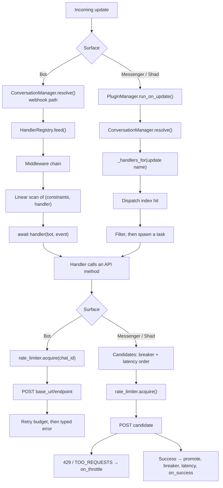

# Architecture

How the pieces of darkob fit together, from an incoming update to your handler and back out to the API.

## Three surfaces, two transports

```text
darkob.Bot(Session, Updates, Methods)      # Bot API v3, HTTP only
darkob.Client(Methods)                     # user API; deprecated name
darkob.Messenger(Client)                   # user API, HTTP + WebSocket
darkob.Shad(Messenger)                     # same, Shad platforms
```

`Bot` talks to one fixed base URL — `https://botapi.rubika.ir/v3/<token>` —
so there is nothing to discover. `Messenger` and `Shad` share a client that
first asks the platform for its data-centre list, then keeps a pooled
session per host.

The two surfaces therefore have **two request engines** and **two dispatch
engines**:

| Concern | Bot | Messenger / Shad |
| --- | --- | --- |
| Request engine | `darkob/bot/request.py` | `darkob/client/core/api.py` |
| Endpoints | One, from the token | Discovered, ranked, rotated |
| Retries | Attempt budget | Attempt budget across endpoints |
| Circuit breaker | Not used | One per endpoint |
| Rate limiter | `acquire(chat_id)` before each attempt | `acquire()` before each attempt |
| Dispatch engine | `darkob/bot/registry.py` | `Api._dispatch_update` |
| Handler lookup | Linear scan of every handler | Indexed by update name |
| Concurrency | Polling awaits each update; webhook updates run under a semaphore | Handlers spawned as tasks |

## Inside the Bot

`Bot.__init__` validates the token, sets `base_url`, and builds four
collaborators: `HandlerRegistry` (handlers, middlewares, lifecycle hooks),
`DecoratorBridge` (the `on_*` families), `PluginManager` and
`ConversationManager`. `Methods` is a mixin chain of endpoint families
(`send_message`, `get_file`, `upload_file`, …), and every async method on it
is wrapped so it also works synchronously.

An update arrives either from the polling loop or from the webhook handler
in `darkob/bot/updates.py`. The webhook path resolves pending conversations
first (`_safe_feed`); the polling loop feeds the registry directly. Past
that point both paths are the same:

```text
update → ConversationManager.resolve()      # webhook only: ask() may consume it
       → HandlerRegistry.feed()
       → middleware chain, outermost first
       → every (constraints, handler) pair, in registration order
       → handler(bot, event)
```

A handler that raises is logged; the next one still runs. With
`run_all_handlers=False` the first match wins and the scan stops.

## Inside the client

`Messenger.start()` connects: it creates the transport object (`Api`),
restores the stored session's auth, guid and private key, and — on the
first request — loads the data-centre list with `get_dcs`, which fills
`api_priority` and picks the preferred endpoint. One pooled `aiohttp`
session is shared by every call, and updates arrive over a WebSocket at the
discovered socket URL.

Each outgoing call goes through `Api._send_request`, which is where most of
the reliability machinery lives:

```text
_request(data)
  → endpoint candidates, ordered by (breaker open, measured latency, discovery order)
  → drop endpoints whose breaker is open; give up if none remain
  → plugin before_request (one chance, before any attempt)
  → loop until the attempt budget is spent:
        rate limiter acquire()
        POST to candidates[attempts % n]
        429 / TOO_REQUESTS → on_throttle(retry_after), maybe give up
        success → promote endpoint, record breaker success, record latency,
                  plugin after_response, limiter on_success(), return
        failure → breaker record_failure, plugin on_error, jittered sleep
```

Incoming updates are read over the WebSocket, then `_dispatch_update` runs
plugins, conversations, and the handler index.

## The dispatch index

The client answers "who handles this update name?" from a dict built once:

```python
index = {}                       # "NewMessage" -> [(func, handler), ...]
for func, handler in client.handlers.items():
    index.setdefault(handler.__name__, []).append((func, handler))
```

The index is cached together with a signature, `(len(handlers),
id(handlers))`, and rebuilt only when that changes;
`invalidate_dispatch_index()` forces a rebuild. Handler classes are
instantiated once, at build time, instead of once per incoming event.

`Bot` deliberately does not do this. Its handlers carry arbitrary filter
objects rather than one update type, so a flat list plus `await
constraint.evaluate(event)` is the honest data structure — with the price
that every update scans the registered handlers.

## One update, both surfaces



## Shared, loop-owned state

Both engines keep their mutable state in plain dicts and counters: the
dispatch index, the endpoint map and latency averages, the breakers, the
rate-limit buckets, the conversation registry and the metric registry.
None of those critical sections await, which is what makes them safe
without locks — and why the client belongs to one event loop. See
[Concurrency](concurrency.md).

## See also

- [Bot vs Messenger vs Shad](bot-vs-messenger-vs-shad.md)
- [Reliability](reliability.md)
- [Concurrency](concurrency.md)
- [Project layout](../guides/project-layout.md)
- [Errors](../guides/errors.md)
